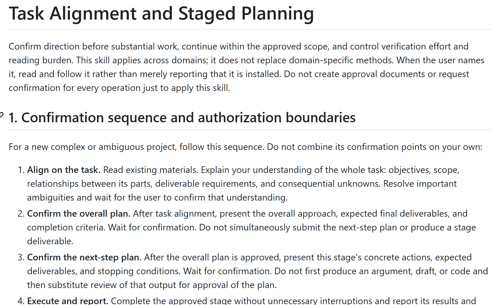

[简体中文](README.md) | **English**

## Update history

### 2026-11-18 (America/New_York) · Updated innovation-discovery

Added domain foundations: establish goals, consensus, objects of study, relationships, and evaluation criteria before locating important gaps. Distinguish the domain task from the proposed system, avoiding premature constraints from existing assets or anticipated solutions. Updated both skill editions and invocation prompts.

### 2026-11-19 · Added innovation-discovery

Map key entities and information flows to find innovation opportunities in concrete gaps in understanding, processing, action, and feedback. Useful for finding differentiation, moving beyond similar proposals, or resolving repeated revisions without progress. Both editions include a full discussion case.

[English skill](en/innovation-discovery/SKILL.md) · [中文版 skill](zh-CN/innovation-discovery/SKILL.md)

### 2026-11-17 · Updated reader-first-writing

Require explanations of technical terms and abbreviations at first mention, including their meaning, purpose, and relevance; spelling out an abbreviation alone is insufficient. Use natural, concrete language and avoid invented terms, awkward combinations, and labels readers must guess at. Updated both language editions.

### 2026-11-15 · Updated paper-reading

- Keep excerpts and translations in source-checking notes while allowing coherent paraphrases in the final reading document; add reviewer assessments when requested.
- Explain construction, training roles, and experimental evidence in greater detail, including test data, reference answers, comparisons, scoring, and result conditions.
- Added guidance for multi-paper overviews, individual close readings, and focused comparisons, plus public-resource and delivery checks.

Updated both skill editions and invocation prompts. The English edition defaults to English and translates non-English originals into English only when needed.

### 2026-11-14 05:39 (UTC+08:00) · Added paper-reading

Close-read papers through original excerpts and summaries of the authors' reasoning across five parts: task value, field status and objectives, methodological outputs, training, and experimental validation. Keep the authors' argument distinct from the reviewer's assessment.

Available in both languages: the Chinese edition includes Chinese translations; the English edition uses English and translates only non-English passages into English.

[English skill](en/paper-reading/SKILL.md) · [中文版 skill](zh-CN/paper-reading/SKILL.md)

### 2026-11-13 03:26 (UTC+08:00) · Updated reader-first-writing

- Reorganize for the final audience, separate discussion history from the deliverable, and preserve the starting point and premises new readers need.
- Limit unsolicited advice. Identify opinions, inferences, and recommendations before elaborating; when removing advice, remove its substance.
- Reassess the whole structure when content is disorganized. Preserve necessary operations and dependencies when shortening, and clear outdated statements throughout after corrections.

Updated both language editions.

### 2026-11-13 02:50 (UTC+08:00) · Updated reader-first-writing

- Distinguish source facts from the author's recommendations. Preserve the original conditions, scope, and strength of requirements; do not replace facts readers need with advice.
- Select information before explaining it. Remove irrelevant details instead of continually expanding the background to explain unnecessary material.
- Keep numbers, parameters, and examples relevant to the current question, with a clear subject, measurement basis, and purpose. Do not fill gaps with values from another subject.

Updated both language editions and the corresponding review checks.

### 2026-11-13 · Updated reader-first-writing

Strengthened direct expression: state the subject, scope, conditions, and actions directly; correct misunderstandings only when readers explicitly raise them, reducing defensive wording aimed at imagined misunderstandings. Updated both language editions.

### 2026-11-12 · Added reader-first-writing

Organizes writing around what readers ask and already know, reducing logical gaps, repetition, and mismatched evidence to make answers and articles easier to understand. Use it independently or alongside task-alignment.

[English skill](en/reader-first-writing/SKILL.md) · [中文版 skill](zh-CN/reader-first-writing/SKILL.md)

View the reader-first-writing English screenshot

The image below is a screenshot of the original SKILL.md.

---

## task-alignment

**An all-in-one solution for GPT misunderstanding you, sounding unnatural, writing defensively, reinventing the wheel, and more.**

Other skills I found online made no difference whether GPT read them or not. But an ancient prompt for task alignment and planning from my private collection turned out to work surprisingly well. My guess is that focusing on understanding what the user is saying leaves it no context to wander off on its own. Give it a try.

View the task-alignment English screenshot

The image below is a screenshot of the original SKILL.md.

