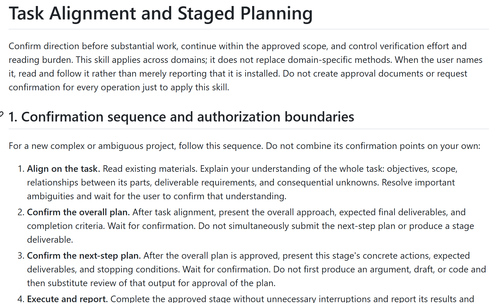

[简体中文](README.md) | **English**

**An all-in-one solution for GPT misunderstanding you, sounding unnatural, writing defensively, reinventing the wheel, and more.**

Other skills I found online made no difference whether GPT read them or not. But an ancient prompt for task alignment and planning from my private collection turned out to work surprisingly well. My guess is that focusing on understanding what the user is saying leaves it no context to wander off on its own. Give it a try.

