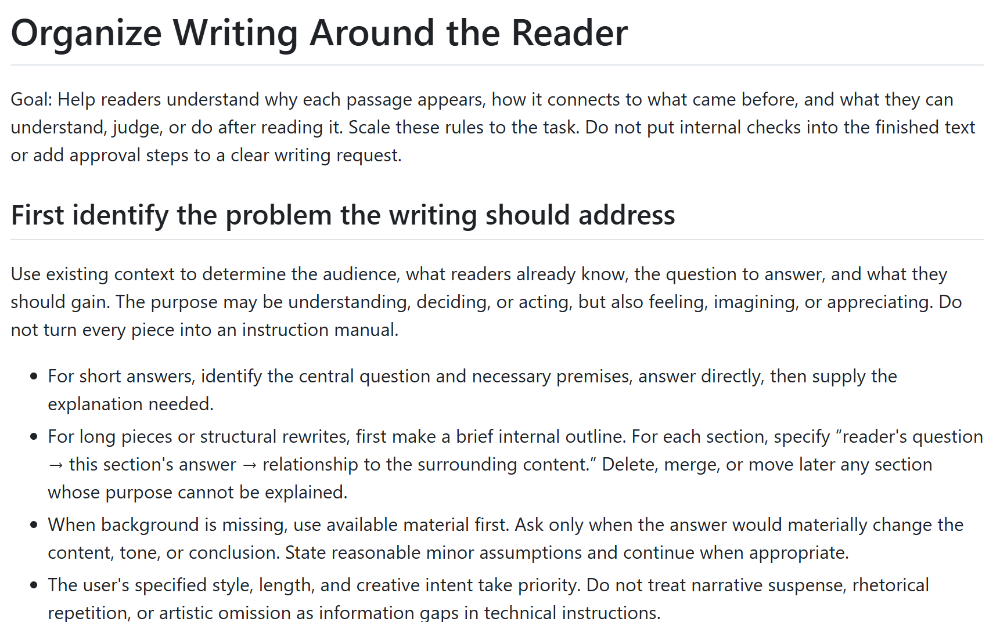

[简体中文](README.md) | **English**

## Update history

### 2026-11-13 · Updated reader-first-writing

Strengthened direct expression: state the subject, scope, conditions, and actions directly; correct misunderstandings only when readers explicitly raise them, reducing defensive wording aimed at imagined misunderstandings. Updated both language editions.

### 2026-11-12 · Added reader-first-writing

Organizes writing around what readers ask and already know, reducing logical gaps, repetition, and mismatched evidence to make answers and articles easier to understand. Use it independently or alongside task-alignment.

[English skill](en/reader-first-writing/SKILL.md) · [中文版 skill](zh-CN/reader-first-writing/SKILL.md)

View the reader-first-writing English screenshot

The image below is a screenshot of the original SKILL.md.

---

## task-alignment

**An all-in-one solution for GPT misunderstanding you, sounding unnatural, writing defensively, reinventing the wheel, and more.**

Other skills I found online made no difference whether GPT read them or not. But an ancient prompt for task alignment and planning from my private collection turned out to work surprisingly well. My guess is that focusing on understanding what the user is saying leaves it no context to wander off on its own. Give it a try.

View the task-alignment English screenshot

The image below is a screenshot of the original SKILL.md.

