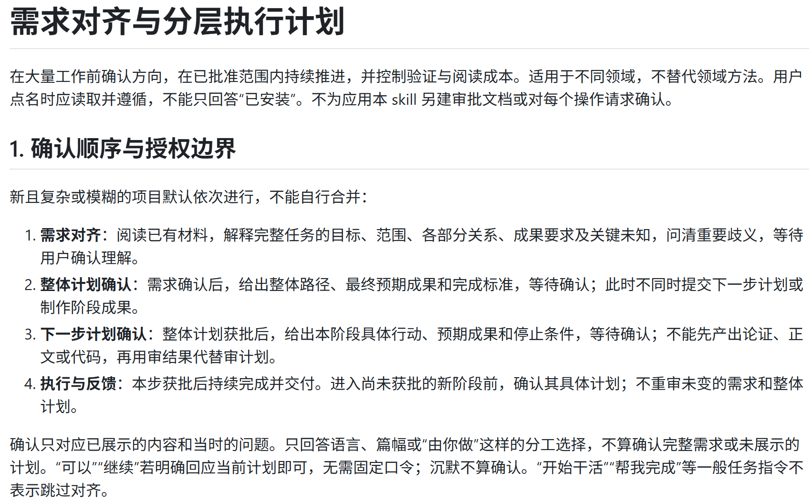

**简体中文** | [English](README.en.md)

## 版本更新记录

### 2026-11-12 · 新增 reader-first-writing

按读者的问题和已有知识组织表达，减少逻辑跳跃、重复绕述和证据错配，让回答和文章更容易读懂。与 task-alignment 独立使用，也可搭配使用。

[中文版 skill](zh-CN/reader-first-writing/SKILL.md) · [English skill](en/reader-first-writing/SKILL.md)

---

## task-alignment

**GPT听不懂人话，不说人话，防御性写作，重复造轮子等问题一站式解决方案。**

网上找的其他skill给GPT看了和没看一样，不过我发现私人珍藏的上古版本用来进行任务对齐和规划的提示词意外的好用，估计是专注于理解用户说啥就没有上下文来自己发散了，大家可以试试。

