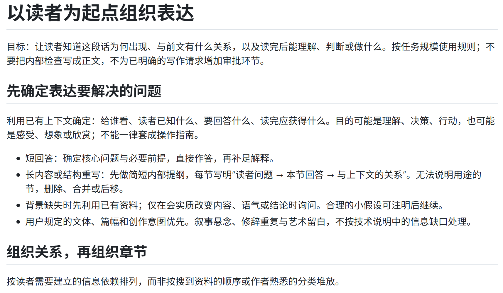

**简体中文** | [English](README.en.md)

## 版本更新记录

### 2026-11-18（America/New_York）· 更新 innovation-discovery

新增“建立领域基础”：先梳理领域目标、共识、研究对象、关系与评价依据，再定位重要缺口；区分领域任务与拟研究系统，避免用现有资产或预想方案限定问题。中英文主文及调用提示同步更新。

### 2026-11-19 · 新增 innovation-discovery

梳理关键对象和信息流，从理解、处理、行动与反馈中的具体缺口寻找创新方向，适用于寻找差异化、方案同质化或反复修改仍无进展的讨论。中英文版均包含完整讨论案例。

[中文版 skill](zh-CN/innovation-discovery/SKILL.md) · [English skill](en/innovation-discovery/SKILL.md)

### 2026-11-17 · 更新 reader-first-writing

明确要求术语和缩写首次出现时解释含义、用途及与当前问题的关系，仅展开全称不算解释；使用自然、具体的表达，避免生造词、别扭组合和需要读者猜测的标签。中英文版本同步更新。

### 2026-11-15 · 更新 paper-reading

- 查证底稿保留摘录与翻译，最终阅读稿可采用连贯转述；按需加入整理者评价。
- 细化方法构建、训练角色及实验依据，讲清测试数据、参考答案、对照、计分和结果条件。
- 新增多篇论文的总览、逐篇精读与专题比较规则，补充公开资源核查与交付检查。

中英文 skill 与调用提示同步更新；英文版默认使用英语，仅在需要时将非英文原文译为英语。

### 2026-11-14 05:39（UTC+08:00）· 新增 paper-reading

按原文摘录、中文翻译和原文逻辑精读论文，围绕任务价值、领域现状与目标、方法产出、训练过程、实验验证五部分展开，区分作者论证与自己的判断。

提供中英文版本：中文版保留中文翻译；英文版使用英语，仅在原文非英语时翻译成英语。

[中文版 skill](zh-CN/paper-reading/SKILL.md) · [English skill](en/paper-reading/SKILL.md)

### 2026-11-13 03:26（UTC+08:00）· 更新 reader-first-writing

- 按最终读者重新组织内容，区分讨论过程与正式交付，保留新读者所需的起点和前提。
- 收紧主动添加建议的范围；观点、推断和建议在展开前标明性质与归属，删除建议时删除实质内容。
- 内容杂乱时重审整篇主线；精简保留必要操作与依赖，修正后同步清除其他位置的旧说法。

中英文版本同步更新。

### 2026-11-13 02:50（UTC+08:00）· 更新 reader-first-writing

- 区分来源事实与作者建议，忠实保留原文的条件、范围和要求强度，不用建议替代读者要查明的事实。
- 先筛选信息，再解释；删除无关细节，避免为了讲清不必要的内容不断扩写背景。
- 数字、参数和示例须对应当前问题，明确对象、口径和用途，不用其他对象的数值填补未知信息。

中英文版本及相应自查规则同步更新。

### 2026-11-13 · 更新 reader-first-writing

强化直接表达：直接说明对象、范围、条件和操作；仅针对读者明确提出的误解进行纠正，减少防范假想误解的防御性文字。中英文版本同步更新。

### 2026-11-12 · 新增 reader-first-writing

按读者的问题和已有知识组织表达，减少逻辑跳跃、重复绕述和证据错配，让回答和文章更容易读懂。与 task-alignment 独立使用，也可搭配使用。

[中文版 skill](zh-CN/reader-first-writing/SKILL.md) · [English skill](en/reader-first-writing/SKILL.md)

查看 reader-first-writing 中文版截图

以下为 SKILL.md 原文截图。

---

## task-alignment

**GPT听不懂人话，不说人话，防御性写作，重复造轮子等问题一站式解决方案。**

网上找的其他skill给GPT看了和没看一样，不过我发现私人珍藏的上古版本用来进行任务对齐和规划的提示词意外的好用，估计是专注于理解用户说啥就没有上下文来自己发散了，大家可以试试。

查看 task-alignment 中文版截图

以下为 SKILL.md 原文截图。

