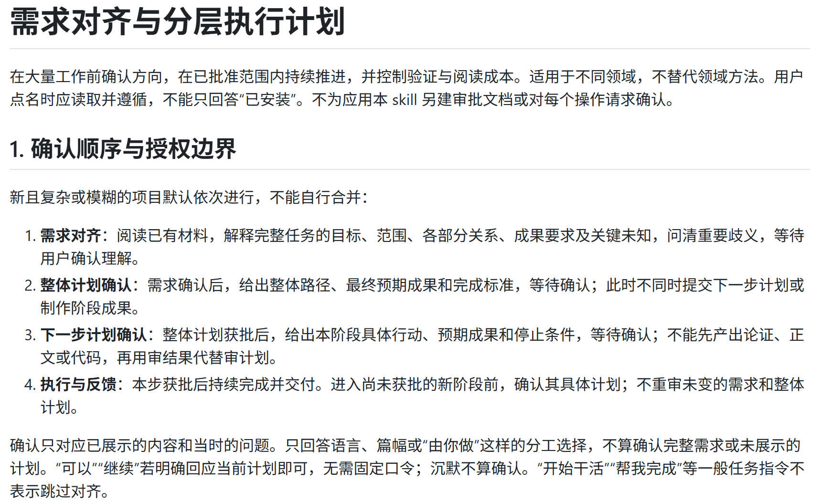
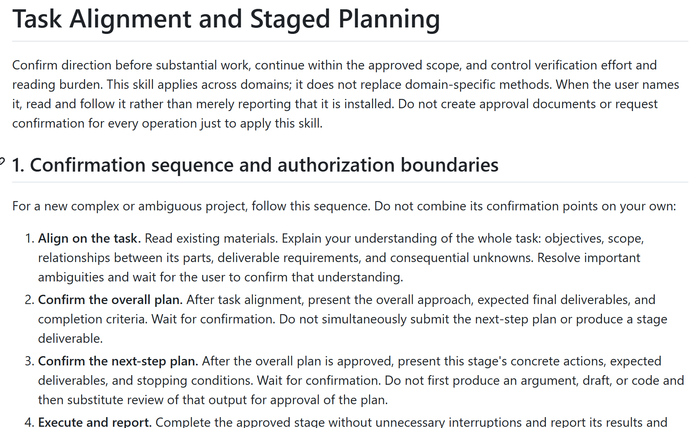

**GPT听不懂人话，不说人话，防御性写作，重复造轮子等问题一站式解决方案。**

网上找的其他skill给GPT看了和没看一样，不过我发现私人珍藏的上古版本用来进行任务对齐和规划的提示词意外的好用，估计是专注于理解用户说啥就没有上下文来自己发散了，大家可以试试。

**An all-in-one solution for GPT misunderstanding you, sounding unnatural, writing defensively, reinventing the wheel, and more.**

Other skills I found online made no difference whether GPT read them or not. But an ancient prompt for task alignment and planning from my private collection turned out to work surprisingly well. My guess is that focusing on understanding what the user is saying leaves it no context to wander off on its own. Give it a try.

